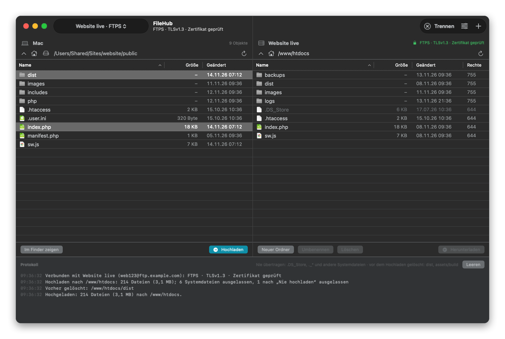

# FileHub

A small file transfer client for the Mac (SwiftUI, macOS 14+): two columns, the Mac on the left, the server on the right, files moved by drag and drop. Deliberately minimal, made for uploading your own web projects. The user interface is in German.



## Features

- **Two columns:** a folder on the Mac on the left, the folder on the server on the right. Dragging from left to right uploads, from right to left downloads; you can also drag from Finder into the server column. Dropping onto a folder puts everything inside it, otherwise into the folder shown. Double-click or Return opens a folder.
- **External drives:** the drive menu in the Mac column lists the home folder, Desktop, Documents, Downloads and every attached drive (SSD, USB stick, memory card, network volume), kept up to date as drives are attached and removed; drives can be ejected from there too. The column title shows which drive you are on. When a drive is unplugged, the column returns to the connection's start folder or the home folder. On first access to an external drive, macOS asks once for permission ("Removable Volumes" or "Network Volumes"); if denied, it can be granted later under System Settings → Privacy & Security → Files and Folders → FileHub. If a connection's start folder is on an SSD that is not attached, the log says so and the column switches there as soon as the SSD is connected. Before downloading, FileHub checks that there is enough free space.
- **Context menu:** right-click a file, several selected files or the free space below the list for the usual actions. Mac column: open, upload, show in Finder, copy path, rename, new folder, move to Trash. Server column: open, download, rename, change permissions, copy path, new folder, delete. A right-clicked row that is not selected becomes the selection, as in Finder.
- **Server actions:** new folder, rename, permissions (the usual owner/group/others grid or the octal number; folders without their contents; the server column shows them as e.g. 644), delete (with confirmation; folders including their contents).
- **Progress:** files and bytes done, speed and time left; the Dock icon shows the percentage and bounces once when a long transfer finishes in the background. The Mac does not go to sleep while a transfer is running.
- **Connections:** as many as you like, selected in the toolbar. Each has its own start folders on Mac and server and its own upload rules.
- **Log:** at the bottom of the window and in `~/Library/Logs/FileHub.log` (never with passwords).

### Keyboard

| Key | Action |
| --- | --- |
| ⌘K / ⇧⌘K | Connect / disconnect |
| ⌘N / ⌘E | New connection / edit connection |
| ⌘R | Refresh both columns |
| ⌘U / ⌘D | Upload / download selection |
| ⌘↓ / ⌘↑ | Open the selected folder / go to the parent folder |
| ⇧⌘N | New folder |
| ⌥⌘C | Copy the path of the selection (or of the folder shown) |
| ⌘⌫ | Server column: delete selection (with confirmation); Mac column: move to Trash |
| Typing | Jumps to the first name that starts with the letters typed |

New folder, rename, copy path and delete act on the column clicked last; in a text field the keys edit the text as usual.

## Upload rules

- **System files are never transferred**, in either direction: `.DS_Store`, `._*` (AppleDouble), `.localized`, `Icon\r`, `.Spotlight-V100`, `.Trashes`, `.fseventsd`, `__MACOSX`, `Thumbs.db`, `desktop.ini` and similar (list in `Sources/FileHub/Rules.swift`), plus `.git`, `.svn`, `.hg`. From exFAT or FAT drives also `System Volume Information`, `$RECYCLE.BIN` and `.Trash-*`; the `._` files macOS creates there for extended attributes are left behind as well. They do not even show up in the left column. Symbolic links are skipped.
- **Delete old data on upload** ("Alte Daten beim Upload löschen", per connection, default `dist`): patterns as for "never upload", e.g. `dist, assets/build`. Only folders at the top level count: the pattern has to name the whole path from the target folder (or from the folder, if you drag a single one), so `dist` matches `dist` but never `assets/dist` or `vendor/lib/dist`. If an upload contains such a folder and it already exists at the destination, the app deletes it completely on the server, without asking, checks that it is really gone, and only then uploads; the log says "Vorher gelöscht: … (n Dateien)". If anything is left over, it aborts instead of mixing old and new files. Between deleting and uploading, the folder is briefly missing on the server. Only folders that are themselves part of the upload are deleted (a single file from `dist` deletes nothing); anything matching "never upload" is never deleted either. Empty field: nothing is deleted.
- **Never upload** ("Nie hochladen", per connection): patterns like `php/config.php, logs, backups, *.sql`. A pattern matches the end of a path, so `config.php` matches in every folder, `php/config.php` only there.
- **Upload last** ("Zuletzt hochladen", per connection, default `dist/version.txt, sw.js`): these files go at the very end, so clients only report a new version once everything is in place.
- **Private credentials are never uploaded:** `.ssh`, `.gnupg`, private SSH keys (`id_rsa`, `id_ed25519` …; public `.pub` files are still uploaded) and FileHub's own export files (`*.filehub`), even if a whole home folder is accidentally dragged into the server column. The log reports how many files were skipped.
- File names are uploaded in NFC (as Linux servers expect). When downloading, the app rejects names containing `..`, `/`, control characters or characters that reverse the text direction (otherwise `invoice<U+202E>fdp.app` would appear to be a PDF); such names do not show up in the server column either.

## Security

- **Encrypted only:** SFTP (over SSH) or FTPS (FTP over explicit TLS). There is no unencrypted FTP: if a server refuses TLS, the connection is aborted.
- **SFTP** runs through macOS's `/usr/bin/ssh` and `/usr/bin/sftp`, without `~/.ssh/config` (`-F /dev/null`) and with its own `known_hosts` in `~/Library/Application Support/FileHub/`. On first contact the app shows the host key fingerprint (SHA256) and only connects after confirmation; after that `StrictHostKeyChecking=yes` applies and a changed key is rejected. "Vergessen …" (forget) in the connection editor removes it if the server really is new. Authentication by password or key file (`IdentitiesOnly`, passphrase from the macOS keychain).
- **FTPS** runs through `/usr/bin/curl` with `--ssl-reqd`, at least TLS 1.2 and always a verified certificate including the host name, so self-signed certificates do not work. With TLS 1.2 only ciphers with forward secrecy and authenticated encryption are allowed (ECDHE with AES-GCM or ChaCha20); curl may only use `ftp://` and only fetches data from the server it is logged in to, never from an address in its PASV reply. Settings are passed to curl line by line; every value is escaped, so a line break in a Mac path stays part of the path and never becomes another setting. Every curl call is a login, so FileHub batches: all folders of one level in one call, creating folders and uploading in one, deleting plus verification in one. A folder to be replaced is read beforehand (one login per folder level); deleting then needs exactly one. If the login fails, curl stops immediately instead of retrying for every folder. If you want as few logins as possible, use SFTP: one per session. Uploads use TLS 1.2: macOS's curl (8.7.1) does not close TLS 1.3 data connections cleanly when uploading, and ProFTPD servers then abort with "426" (curl issue #13556, fixed in curl 8.9). Listing and downloading stay on TLS 1.3.
- **Passwords** are stored only in the keychain (service "FileHub", one item for all connections), never in files, arguments or the log. They reach `curl` via stdin and `ssh` via an askpass bridge: the app itself acts as `SSH_ASKPASS` and hands over the password through a Unix socket with a one-time token, only to the same user, only once. FileHub reads the item once per launch and keeps the passwords in the app's memory afterwards. After every rebuild, macOS asks twice whether FileHub may read the item: choose "Always Allow" both times and it stays quiet until the next rebuild (with "Allow" it asks on every launch). Avoiding the prompts after rebuilds entirely would require an Apple development certificate (team ID), because macOS identifies ad hoc signed apps by the hash of their executable.
- **Ad hoc signed with Hardened Runtime:** foreign libraries cannot be injected into the running app; `build.sh` verifies signature and runtime after every build. The app never loads code at runtime, has no update mechanism, no plug-ins and no URL scheme; it only runs macOS's own tools in `/usr/bin` (curl, ssh, sftp, ssh-keygen, ssh-keyscan) with a fixed, minimal environment (no proxy variables, no `~/.curlrc` or `~/.ssh/config`).
- **Interrupted transfers** never leave a half file under the real name: uploads from 1 MB and all downloads go to a hidden `.<name>.filehub-part` first and are renamed when complete (same login, no extra connection). If the connection drops during an upload (timeout, reset, 426/451), FileHub reconnects and continues from the file that broke, up to three times; if it still fails, the log says whether the server is unchanged or the upload is incomplete. Cancelling stops both upload connections at once. A server folder you cannot read shows "Kein Zugriff" instead of switching to another listing command, and folder trees deeper than 64 levels are refused (usually a link loop).
- **Downloads** get macOS's quarantine flag like a download from Safari: Gatekeeper checks a program or script from the server before it is first opened. On exFAT/FAT drives the flag is omitted, otherwise a `._` file would appear next to every file. FileHub itself never opens a file; double-click only opens folders, and icons come from kind and extension, not from the file.
- **Imported host keys** (setup file) are only accepted as plain "host type key" lines; entries like `@cert-authority`, wildcards or lists that would trust more than one server are discarded. Invalid connections in the file are left out, and files over 5 MB are not read at all.
- The lock in the toolbar shows what the connection actually uses (protocol, cipher or TLS version, certificate or host key).

## Building

Only the Command Line Tools are needed, no Xcode:

```bash
./build.sh            # build/FileHub.app
./build.sh --install  # also copy to /Applications/StudioHub (quit FileHub first)
./build.sh --icon     # redraw the app icon (scripts/make-icon.swift)
scripts/check.sh      # offline checks: rules, listings, paths, encryption, askpass
scripts/check.sh --server  # also against the local Docker test server
scripts/e2e.sh        # real app run against the test server, including an exFAT image as external SSD
scripts/snapshot.sh   # window images with demo data in build/snapshot/
scripts/testserver.sh stop  # remove the test server (Docker/OrbStack)
scripts/pack.sh       # build/FileHub-<version>.zip for building on a Mac without the repo
```

The test server (`Tests/server/`) offers SFTP, FTPS with vsftpd (LIST), Pure-FTPd (MLSD) and ProFTPD (configured like a typical shared host) plus FTP without TLS (which must be refused), on 127.0.0.1 only. `scripts/testserver.sh delay 40` simulates 40 ms of network latency, `delay 0` turns it off. Its credentials and test CA are test values only; only the check runs trust them.

## Other Macs

Build the app on each Mac yourself: Gatekeeper blocks a copied, only ad hoc signed app.

1. Install the Command Line Tools (`xcode-select --install`).
2. `git clone git@github.com:marionitschke/filehub.git` (or unpack the ZIP from `scripts/pack.sh`), then run `./build.sh --install` in the folder.
3. On the configured Mac, choose "Verbindung → Verbindungen exportieren …" (export connections): this creates `FileHub-Verbindungen.filehub`, encrypted with a password (at least 10 characters; PBKDF2-SHA256, 600,000 rounds, AES-GCM). It contains connections, saved passwords and confirmed host keys, but **no** SSH key files; copy those to `~/.ssh/` yourself if needed.
4. Send the file to the other Mac via AirDrop, choose "Verbindungen importieren …" (import connections) there, then delete the file on both Macs.

Before passing the app on, increase the version in `Resources/Info.plist` so old and new builds can be told apart under "Über FileHub" (About FileHub).

## Data

- `~/Library/Application Support/FileHub/servers.json` (connections without passwords) and `known_hosts`, both readable by the user only.
- Keychain: service "FileHub", account "Zugangsdaten".
- `~/Library/Logs/FileHub.log`, rotated at 2 MB.
